# ShopSphere API

A REST API for a small online store. It manages users, products and product categories with MongoDB, JWT authentication and role-based access.

Built as Task 1 of my internship at Webora Tech.

## Features

- JWT authentication (register, login, profile)
- Two roles: `customer` and `admin`. Only admins can create, update or delete products and categories
- Full CRUD for products and categories
- Pagination, search, filtering and sorting for product listings
- Request validation with clear error messages (Joi)
- Consistent JSON responses and proper HTTP status codes
- A category cannot be deleted while it still has products
- Interactive API documentation with Swagger UI

## Tech Stack

- Node.js and Express
- MongoDB with Mongoose
- JSON Web Tokens and bcryptjs
- Joi (validation)
- Swagger UI (OpenAPI 3)
- Helmet, CORS and Morgan

## Project Structure

```
shopsphere-api/
├── src/
│   ├── config/        database connection
│   ├── controllers/   request handlers
│   ├── docs/          OpenAPI (Swagger) specification
│   ├── middleware/    auth, validation, error handler
│   ├── models/        Mongoose models (User, Category, Product)
│   ├── routes/        route definitions
│   ├── utils/         helpers (ApiError, response, slugify)
│   ├── validators/    Joi schemas
│   └── app.js
├── screenshots/       API test screenshots
├── server.js
├── .env.example
└── package.json
```

## Setup

### 1. Requirements

- Node.js 18 or newer
- A MongoDB database (MongoDB Atlas free tier works fine)

### 2. Install

```bash
git clone https://github.com/rabiaazam2021-code/shopsphere-api.git
cd shopsphere-api
npm install
```

### 3. Environment variables

Create a `.env` file in the project root (see `.env.example`):

```
PORT=5000
MONGO_URI=your_mongodb_connection_string
JWT_SECRET=your_long_random_secret
NODE_ENV=development
```

### 4. Run

```bash
npm run dev     # development (nodemon)
npm start       # production
```

The API runs at `http://localhost:5000` and the docs at `http://localhost:5000/api-docs`.

### 5. Create an admin

Every new user is a `customer`. To make a user an admin, open the `users` collection in MongoDB and change the `role` field to `admin`.

## API Documentation

Swagger UI: `http://localhost:5000/api-docs`

To test protected routes: log in, copy the token, click **Authorize** and paste it.

## Response Format

Success:

```json
{
  "success": true,
  "message": "Product created successfully",
  "data": {}
}
```

Error:

```json
{
  "success": false,
  "message": "Validation failed",
  "errors": ["price must be greater than or equal to 0"],
  "data": null
}
```

## Endpoints

| Method | Endpoint | Access | Description |
|---|---|---|---|
| POST | `/api/auth/register` | Public | Register a new customer |
| POST | `/api/auth/login` | Public | Login and get a token |
| GET | `/api/auth/me` | Logged in | Get own profile |
| GET | `/api/categories` | Public | List categories |
| GET | `/api/categories/:id` | Public | Get one category |
| POST | `/api/categories` | Admin | Create a category |
| PUT | `/api/categories/:id` | Admin | Update a category |
| DELETE | `/api/categories/:id` | Admin | Delete a category (only if it has no products) |
| GET | `/api/products` | Public | List products (pagination, search, filter, sort) |
| GET | `/api/products/:id` | Public | Get one product |
| POST | `/api/products` | Admin | Create a product |
| PUT | `/api/products/:id` | Admin | Update a product |
| DELETE | `/api/products/:id` | Admin | Delete a product |

## Product Listing Query Parameters

| Parameter | Example | Description |
|---|---|---|
| `page` | `1` | Page number (default 1) |
| `limit` | `10` | Items per page (default 10, max 50) |
| `search` | `phone` | Search in name and description |
| `category` | `6ae10df5...` | Filter by category id |
| `minPrice` | `100` | Minimum price |
| `maxPrice` | `1000` | Maximum price |
| `inStock` | `true` | Only products with stock above 0 |
| `sort` | `-price` | Sort by `price`, `name`, `createdAt` or `stock`. Add `-` for descending |

Example:

```
GET /api/products?page=1&limit=5&search=phone&minPrice=100&maxPrice=1000&sort=-price
```

## HTTP Status Codes

| Code | Meaning |
|---|---|
| 200 | OK |
| 201 | Created |
| 400 | Validation error, invalid id or invalid query |
| 401 | Missing or invalid token, or wrong credentials |
| 403 | Logged in but not an admin |
| 404 | Resource not found |
| 409 | Duplicate value, or category still has products |
| 500 | Internal server error |

## Screenshots


### Authentication
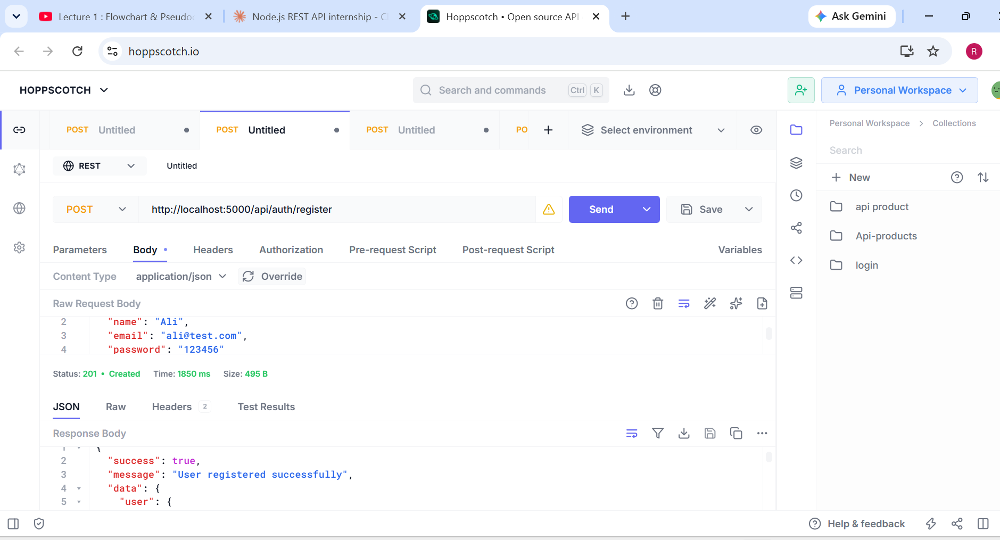
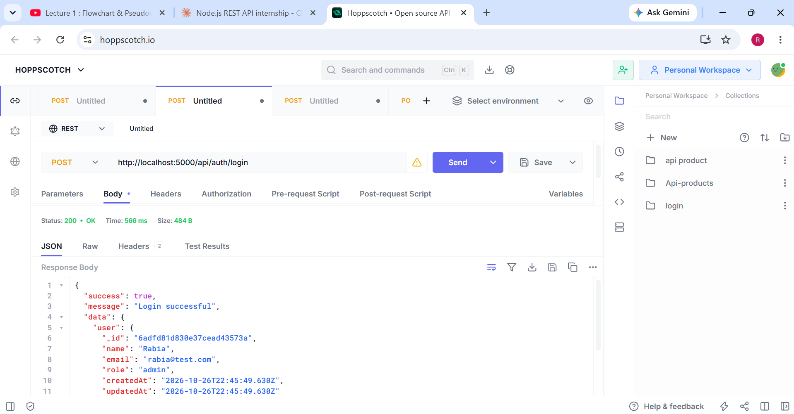
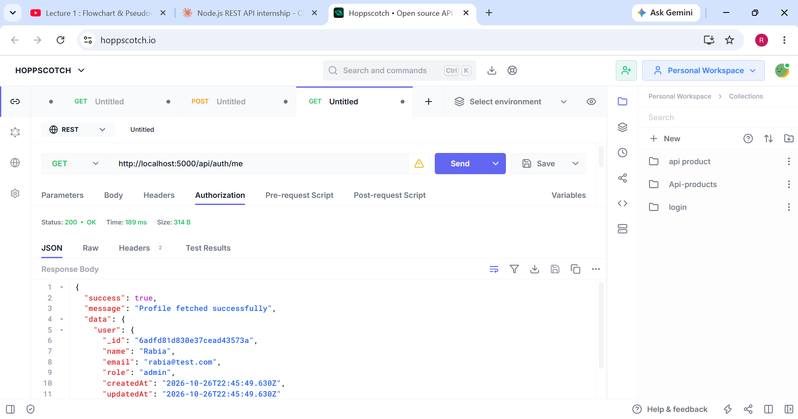

### Categories
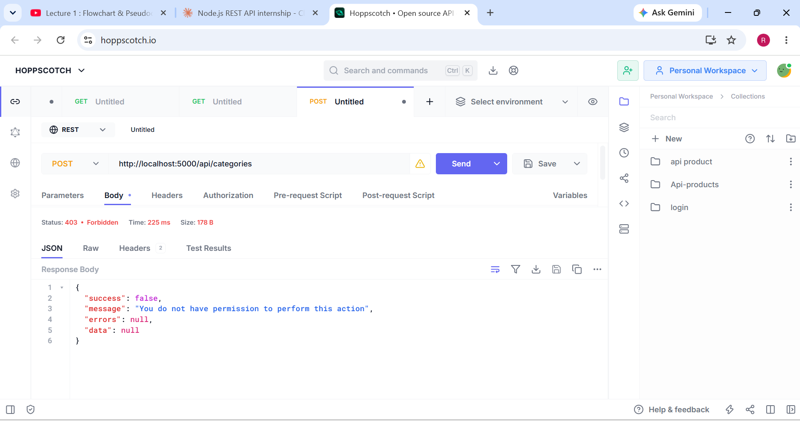
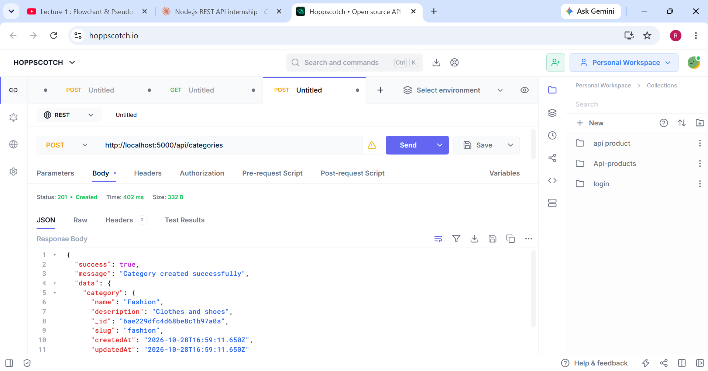
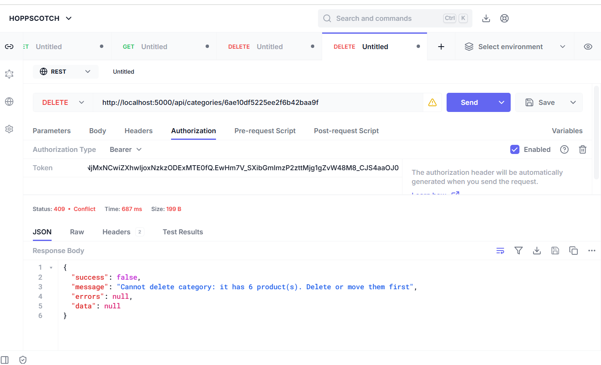

### Products
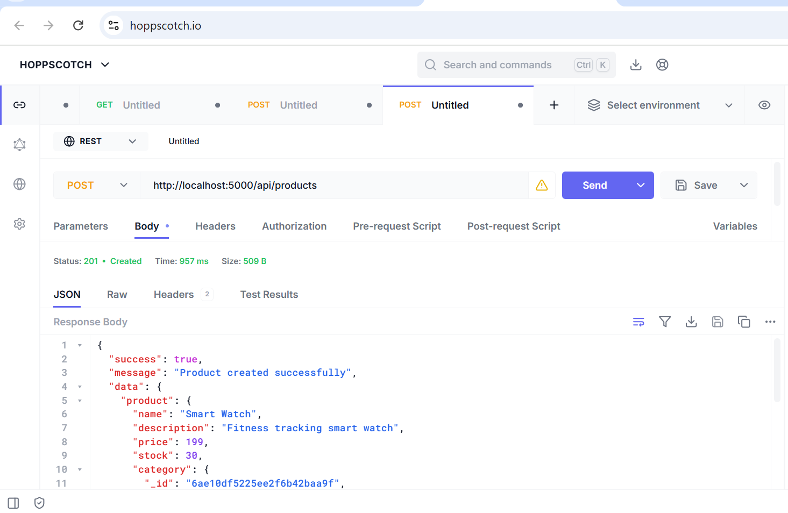
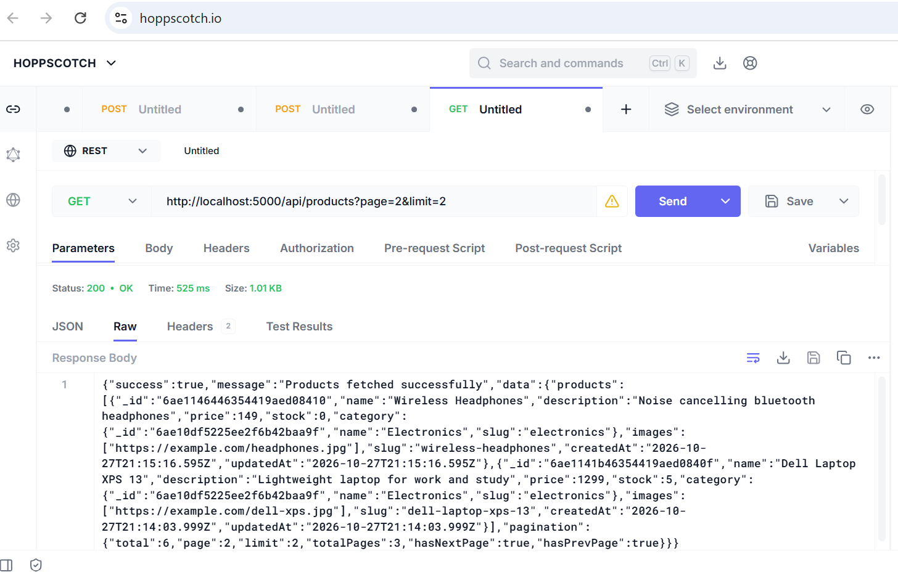
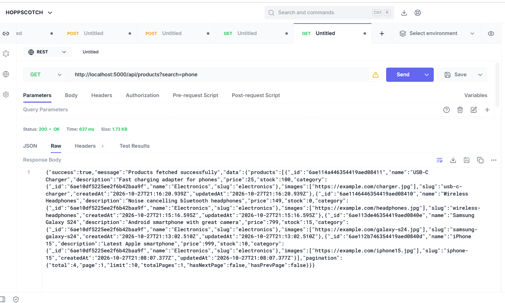
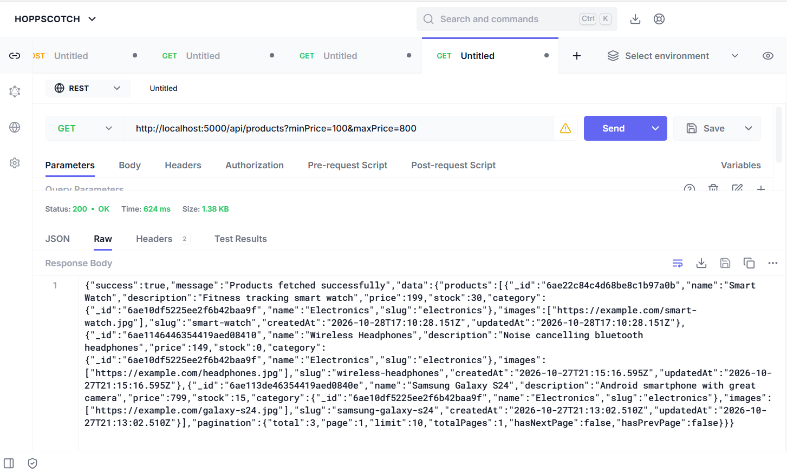
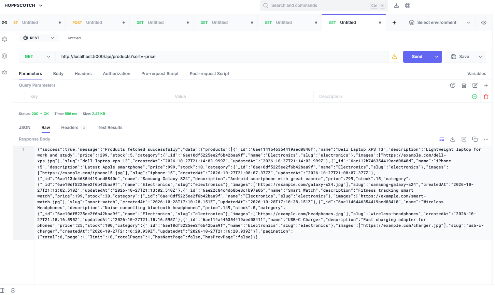

### Validation
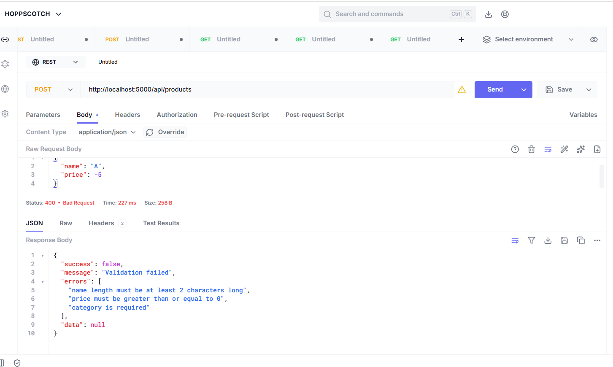

### Swagger Docs
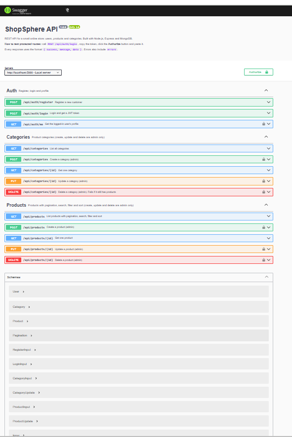
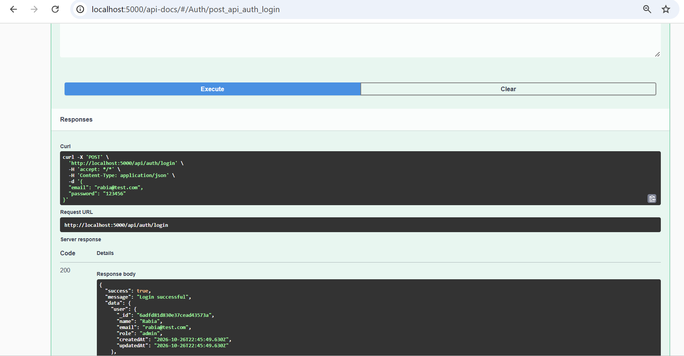

## Author

Rabia Azam
GitHub: [rabiaazam2021-code](https://github.com/rabiaazam2021-code)
LinkedIn: [Rabia Azam](https://www.linkedin.com/in/rabia-azam-404aa1333)